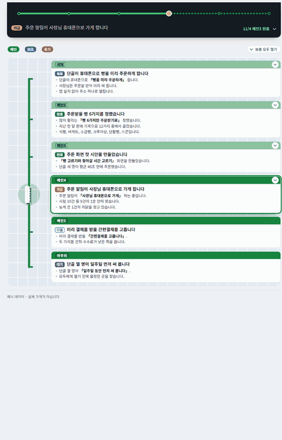
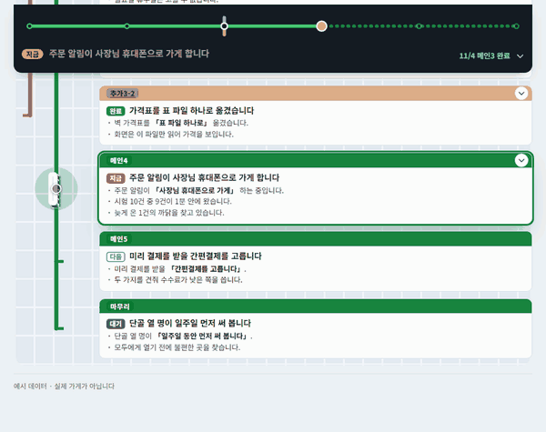
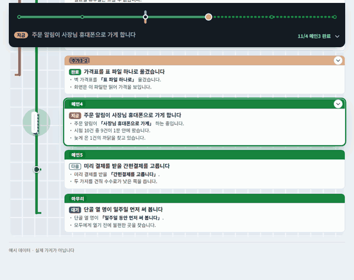
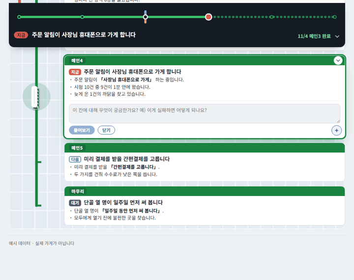
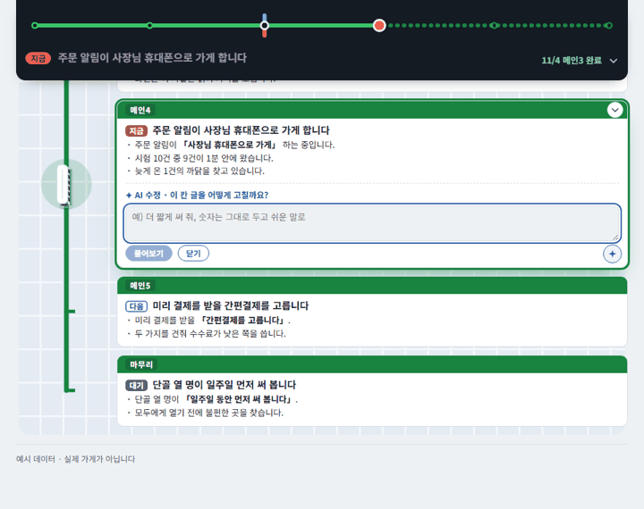
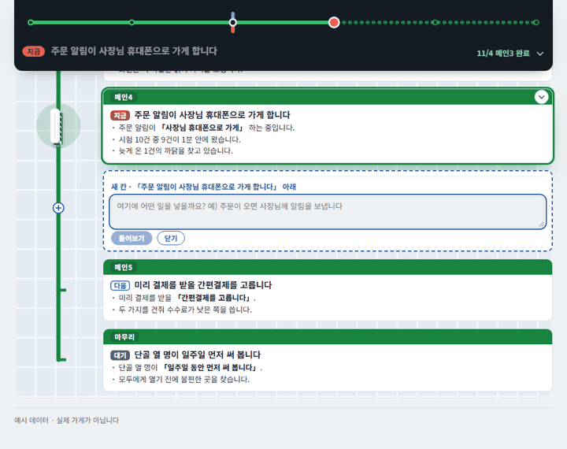
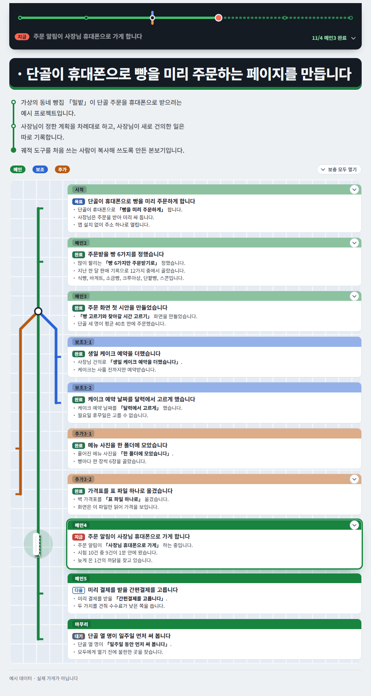
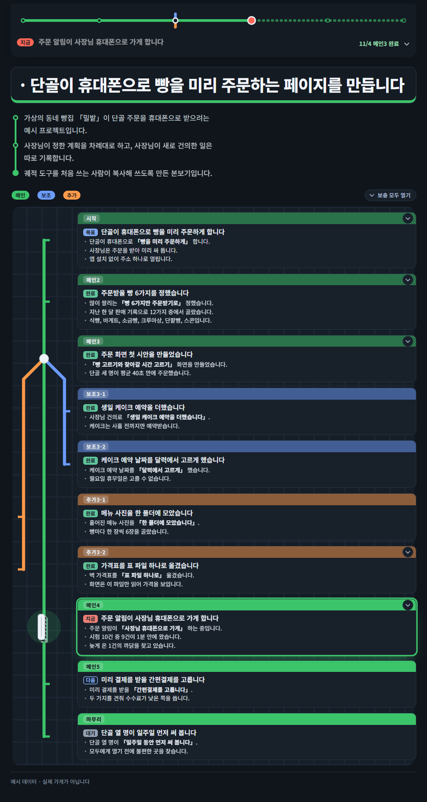

# roadmap-for-vibe-coding

[English](README.md)

**클로드에게 맡긴 일이 어디까지 왔는지, 지하철 노선도 한 장으로 봅니다.**


<p align="center">
  
</p>

1. **처음에는 메인 줄 하나뿐입니다.** 처음 세운 계획이 위에서 아래로 역이 됩니다.
2. **새로 맡긴 일은 보조 줄로 갈라집니다.** 오른쪽 파란 줄입니다. 그림에서는 사장님이 나중에 부탁한 생일 케이크 주문입니다.
3. **일을 거든 정리는 추가 줄로 갈라집니다.** 왼쪽 주황 줄입니다. 그림에서는 메뉴 사진 정리와 가격표 옮기기입니다.
4. **일을 끝내면 열차가 다음 역으로 갑니다.** 떠난 역은 「완료」가 되고 새 역이 「지금」이 됩니다.

메인 줄은 사용자만 늘립니다. 클로드는 새 일을 보조나 추가 줄에 답니다.

## 바로 써 보기

터미널에서 두 줄을 돌립니다.

```bash
claude plugin marketplace add octooking-byte/roadmap-for-vibe-coding
claude plugin install roadmap-for-vibe-coding@roadmap-for-vibe-coding-market
```

그다음 클로드 코드에 이렇게 말합니다.

> 이 프로젝트 궤적 만들어 줘

클로드가 계획을 묻습니다. 그다음 데이터 파일을 쓰고 화면을 만듭니다.

깔지 않고 구경만 하려면 저장소를 받아 `예시/궤적예시.html`을 브라우저로 엽니다. 데스크톱 앱과 VS Code에서 까는 법은 아래 [설치](#설치)에 있습니다.

## 이 궤적을 쓰면 좋은 점

### 1. 계획과 끼어든 일이 섞이지 않습니다

클로드와 며칠 일하면 「이것도 해 줘」가 계속 붙습니다. 할 일 목록 하나에 다 적으면 처음 계획이 어디까지 왔는지 안 보입니다.

이 궤적은 줄을 나눕니다. 계획은 메인 줄에 그대로 남습니다. 새로 맡긴 일은 옆 줄로 갈라집니다. 메인 줄만 따라 내려가면 계획이 몇 번째 역까지 왔는지 보입니다.

### 2. 클로드가 계획을 마음대로 바꾸지 못합니다

메인 줄에서 카드를 더하거나 빼거나 순서를 바꾸면 생성기가 멈춥니다. 사람이 `--메인승인 "까닭"`을 붙여야 다시 만듭니다. 승인한 글은 날짜와 함께 데이터에 쌓입니다. 계획이 언제 왜 바뀌었는지 나중에 찾을 수 있습니다.

### 3. 진행판을 손으로 고치지 않습니다

일이 끝나면 클로드에게 「궤적 갱신해 줘」라고 합니다. 클로드가 JSON 파일 하나를 고치고 명령 한 줄로 화면을 다시 만듭니다.

맨 위 띠에는 마지막으로 끝낸 메인 카드와 날짜가 보입니다. 갱신이 밀린 판은 그 날짜로 알아봅니다.

### 4. 카드가 길어지지 않습니다

카드 한 장은 제목 한 줄과 요약 1~3문장입니다. 제목은 36자, 요약 한 문장은 45자까지입니다. 넘으면 점검기가 화면을 만들지 않고 고칠 카드를 알려 줍니다. 클로드가 여러 날 써도 카드 길이가 그대로입니다.

### 5. 보는 화면에서 바로 고칩니다

카드를 끌어 순서를 바꿉니다. 열차를 끌어 일을 끝냅니다. 잘못 옮겼으면 50단계까지 되돌립니다.

claude.ai에서는 카드마다 클로드에게 물어봅니다. 글 고치기와 새 카드 쓰기도 그 자리에서 맡깁니다. 아래 [할 수 있는 일 전부](#할-수-있는-일-전부)에 움직이는 그림으로 보입니다.

### 6. 서버도 가입도 깔 꾸러미도 없습니다

데이터는 내 저장소 안의 JSON 파일 하나입니다. 바뀐 내용은 git으로 봅니다. 생성기는 파이썬 표준 라이브러리만 씁니다. 화면은 HTML 한 장이라 파일로 바로 열립니다.

## 할 수 있는 일 전부

### 손으로 옮기기

**카드를 끌어 순서를 바꿉니다.** 끄는 동안 놓일 자리에 파란 틈이 생깁니다. 화면 아래에는 휴지통이 뜹니다. claude.ai에서는 「AI 수정」 칸도 함께 뜹니다.

**카드를 버립니다.** 끄는 카드를 휴지통에 놓으면 버려집니다. 버린 카드는 노선도 위 「버린 칸 N개」 목록에 모입니다. 「되살리기」를 누르면 제자리로 돌아옵니다.


**열차를 끌어 카드를 끝냅니다.** 열차를 다음 역으로 옮기면 떠난 카드는 오늘 날짜로 「완료」가 됩니다. 새로 선 역은 「지금」이 됩니다.



**카드를 보조나 추가 줄로 옮깁니다.** 카드 옆 역 점을 끌어 보조나 추가 줄에 놓으면 그 카드가 그 줄로 옮겨 갑니다. 역 점을 다른 역에 놓으면 두 역을 선으로 잇습니다.



### 클로드와 함께

이 세 가지는 화면을 claude.ai 아티팩트로 올렸을 때 됩니다. 그림 속 클로드의 글은 예시 문구입니다.

**카드마다 물어봅니다.** 카드 오른쪽 아래 ✦ 단추를 누르고 질문을 씁니다. 클로드가 그 카드의 글을 읽고 답합니다.



**글 고치기를 맡깁니다.** 카드를 「AI 수정」 칸으로 끌거나, 카드를 고르고 E 키를 누릅니다. 어떻게 고칠지 쓰면 클로드가 고친 글을 먼저 보여 줍니다. 「넣기」를 눌러야 카드가 바뀝니다.



**선을 눌러 새 카드를 넣습니다.** 두 카드 사이 선에 마우스를 올리면 ＋가 뜹니다. ＋를 누르고 넣을 일을 쓰면 클로드가 그 자리에 맞는 카드를 씁니다.



### 그 밖의 기능

- **지금 위치**: 맨 위 띠에 메인 역이 왼쪽부터 놓입니다. 지금 역에는 빨간 점이 찍힙니다. 역을 누르면 그 카드로 갑니다.
- **이어 보기**: 지난번 「지금」 카드가 그사이 끝났으면 열차가 새 역까지 달려갑니다. 알림도 함께 뜹니다.
- **줄 설명**: 노선도 위 메인, 보조, 추가를 누르면 말풍선이 뜹니다. 보조와 추가 말풍선은 그 궤적의 실제 카드를 예로 들어 설명합니다.
- **보충 설명**: 카드 오른쪽 위 화살표를 누르면 숫자 근거 같은 보충 줄이 열립니다. 「보충 모두 열기」는 전부 엽니다.
- **되돌리기**: 띠 아래 「↶ 뒤로」나 Ctrl+Z로 50단계까지 되돌립니다.
- **시작, 마무리, 보류**: 첫 메인 카드는 「시작」, 마지막 메인 카드는 「마무리」로 보입니다. 보류 카드는 빗금과 점선 테두리를 두르고 선로 밖에 놓입니다.
- **마감**: 마감 날짜를 적은 카드는 D-day를 셉니다.
- **키보드**: Alt+↑↓로 카드를 옮기고 Delete로 버립니다. E는 AI 수정입니다. 열차에서는 ↑↓로 옮깁니다. 띠에서는 ←→로 역을 고릅니다.
- **트랙 여러 개**: 한 궤적에 트랙을 여럿 두고 탭으로 오갑니다.
- **저장**: claude.ai에서는 아티팩트에 저장됩니다. 파일로 열면 이 브라우저에 저장됩니다. 「바꾼 것 내보내기」로 파일을 받습니다.
- **화면 모드**: 기기 설정을 따라 밝은 화면과 어두운 화면이 바뀝니다. 휴대폰 화면에도 맞습니다.
- **영어 화면**: 데이터에 `"언어": "en"`을 쓰면 화면 글이 영어로 나옵니다.

## 전체 화면

| 밝은 화면 | 어두운 화면 |
|---|---|
|  |  |

## 설치

파이썬 3.8 이상이 있어야 합니다. 실제로 돌려 본 판은 3.10과 3.11입니다. 윈도우는 `py -3`, 맥과 리눅스는 `python3`로 부릅니다.

**터미널의 클로드 코드**에서는 [바로 써 보기](#바로-써-보기)의 두 줄을 돌립니다.

**클로드 데스크톱 앱(코드 탭)이나 VS Code 확장**에서는 클로드에게 이렇게 보냅니다.

> https://github.com/octooking-byte/roadmap-for-vibe-coding 깔아줘

클로드가 돌리는 명령을 허락하고 새 대화를 엽니다. 클로드는 [INSTALL.md](INSTALL.md)를 읽고 깝니다.

**클로드 없이** 쓰려면 저장소를 받습니다. 화면 만들기는 파이썬만 있으면 됩니다.

## 첫 궤적 만들기

클로드 코드에서는 말로 합니다.

- 「이 프로젝트 궤적 만들어 줘」: 클로드가 계획을 묻고 첫 화면을 만듭니다.
- 「궤적 갱신해 줘」: 끝낸 카드를 완료로 바꾸고 열차를 옮깁니다.
- 「이 일은 보조 줄에 달아 줘」: 계획 밖의 일을 옆 줄에 답니다.

손으로 만들 때는 세 단계입니다.

1. `예시/궤적데이터.json`을 내 프로젝트 폴더에 복사합니다.
2. 머리글과 카드를 내 일로 바꿉니다. `출력`에는 만들 화면 이름을 쓰고 `갱신` 줄은 지웁니다. 가장 작은 모양은 아래와 같습니다.
3. `python3 엔진/궤적만들기.py 내폴더/궤적데이터.json`을 돌립니다.

```json
{ "판": 9, "출력": "궤적.html",
  "머리": {"창제목": "빵집 궤적", "제목": "단골이 휴대폰으로 빵을 미리 주문하게 합니다",
           "부제목": ["빵집 주문 앱을 만드는 일입니다."], "바닥": "2026 동네 빵집"},
  "트랙": [{"키": "bake", "이름": "주문 앱", "노드": [
    {"id": "b1", "축": 0, "상태": "목표", "질문": "단골이 빵을 미리 주문합니다", "요약": "휴대폰으로 주문받습니다.", "보충": []},
    {"id": "b2", "축": 0, "상태": "지금", "날짜": "11/13", "질문": "주문 화면을 만듭니다", "요약": "빵 6가지를 고르는 화면입니다.", "보충": []},
    {"id": "b3", "축": 1, "상태": "대기", "축이름": "결제", "질문": "간편결제를 붙입니다", "요약": "미리 결제를 받습니다.", "보충": []}]}]}
```

| 칸 | 쓰는 법 |
|---|---|
| `id` | 영문으로 시작, 한 번 붙이면 바꾸지 않음 |
| `축` | 숫자 0(메인), 1(보조), -1(추가). 따옴표 없이 |
| `상태` | 목표, 완료, 지금, 대기, 보류, 다음. 지금은 트랙마다 하나까지 |
| `날짜` | 완료와 지금 카드에 `MM/DD`. 완료 카드에 없으면 경고가 뜸 |
| `마감` | 있을 때만 `YYYY-MM-DD` |
| `질문` | 카드 제목. 36자 안, 「~합니다」나 「~요」로 끝나는 한 문장 |
| `요약` | 1~3문장, 한 문장 45자 안 |
| `보충` | 0~3줄 목록, 한 줄 60자 안. 없으면 `[]` |
| `축이름` | 보조와 추가 카드의 꼬리표 |

- 규칙에 어긋나면 생성기는 화면을 만들지 않습니다. 고칠 곳을 한 줄씩 알려 줍니다.
- 문장 안에서 가운뎃점(·)으로 낱말을 늘어놓지 않습니다. 점검기가 막습니다.
- 굵게 보일 곳은 `**「…」**`로 씁니다. 백틱(`` ` ``)으로 감싸면 코드 글자로 보입니다.
- 영어 키로 쓰는 법은 [skills/roadmap/SKILL.md](skills/roadmap/SKILL.md)에 있습니다.

## 어디서 무엇이 되나

화면은 claude.ai 아티팩트로 올리거나 파일로 엽니다. 여는 곳에 따라 되는 기능이 다릅니다.

| 기능 | claude.ai 아티팩트 | 파일로 열기 |
|---|---|---|
| 노선도 보기, 카드 끌기, 열차 옮기기, 줄 잇기 | 됩니다 | 됩니다 |
| 되돌리기, 키보드로 카드 옮기기 | 됩니다 | 됩니다 |
| 고친 것 저장 | 아티팩트 저장소 | 이 브라우저에만 |
| 「바꾼 것 내보내기」 단추 | 없습니다 | 있습니다 |
| ✦ 묻기, AI 수정, 새 카드 넣기 | 됩니다 | 안 됩니다 |

- 줄 잇기와 줄 옮기기는 아직 마우스나 손가락으로만 됩니다.
- 「이 브라우저에만」은 브라우저의 localStorage에 둔다는 뜻입니다. 다른 컴퓨터나 다른 브라우저에서는 보이지 않습니다.
- 사생활 보호 창처럼 localStorage가 막힌 곳에서는 화면에서만 바뀝니다. 화면 위에 그렇게 적힙니다.
- 화면은 크롬과 엣지 최신판에서 확인했습니다. 파이어폭스와 사파리에서는 아직 돌려 보지 못했습니다.

데이터를 고치는 일은 파이썬 3와 JSON 파일만 씁니다. 그래서 파일을 고치고 명령을 돌릴 수 있는 AI 코딩 도구라면 어디서든 됩니다. 실제로 돌려 본 도구는 클로드 코드뿐입니다.

## 자주 묻는 말

**클로드가 없어도 쓸 수 있나요?**
네. 화면 보기, 카드 끌기, 열차 옮기기, 되돌리기는 파일로 열어도 됩니다. ✦ 묻기와 AI 수정, 새 카드 넣기만 claude.ai에서 됩니다.

**내 데이터가 어디로 가나요?**
가지 않습니다. 생성기와 점검기는 내 컴퓨터에서만 돌고 아무 데도 보내지 않습니다. 화면은 글꼴(Noto Sans KR)만 구글 폰트에서 받습니다. 인터넷이 없으면 기기 글꼴로 보입니다.

**메인 줄을 바꾸고 싶으면 어떻게 하나요?**
데이터에서 메인 카드를 고친 뒤 `--메인승인 "바꾼 까닭"`을 붙여 생성기를 돌립니다. 그 글은 데이터의 `메인기록`에 쌓입니다. 생성기는 지난번에 만든 HTML과 견줘 바뀐 것을 찾습니다. 그 HTML을 지우지 말고 JSON 옆에 둡니다.

**화면에서 고친 것이 다시 만들 때 사라지나요?**
먼저 데이터로 옮기면 남습니다. 「바꾼 것 내보내기」로 받은 파일을 `python3 엔진/궤적접기.py 궤적데이터.json 받은파일.json`에 넣습니다. 버린 카드는 옮기지 않고 몇 장인지만 알려 줍니다. 클로드 코드에서는 클로드가 갱신할 때 이 일을 합니다.

**생성기가 위반을 찍고 멈춥니다.**
찍힌 카드를 고치고 다시 돌립니다. 대개 제목이나 요약이 길어서 생깁니다.

**생성기 메시지가 한국어로만 나오나요?**
네. 생성기와 점검기의 메시지는 한국어입니다. 화면 글은 영어로 바꿀 수 있습니다.

## 어떻게 돌아가나

- `엔진/궤적만들기.py`가 JSON을 읽고 점검기 `엔진/궤적점검.py`를 돌린 뒤, 틀 `엔진/궤적틀.html`로 HTML 한 장을 씁니다.
- `엔진/궤적접기.py`는 화면에서 고친 것을 JSON으로 옮깁니다.
- `skills/roadmap/SKILL.md`는 클로드가 읽는 사용 설명입니다.

## 고칠 곳을 찾았다면

[이슈](https://github.com/octooking-byte/roadmap-for-vibe-coding/issues)에 남겨 주세요. 어떤 화면에서 무엇을 했는지 적어 주시면 고치기 쉽습니다.

써 보고 쓸 만했다면 별을 눌러 주세요. 다음 사람이 이 저장소를 찾는 데 도움이 됩니다.

## 라이선스

MIT. [LICENSE](LICENSE)를 봅니다.
