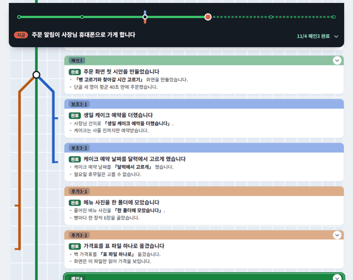
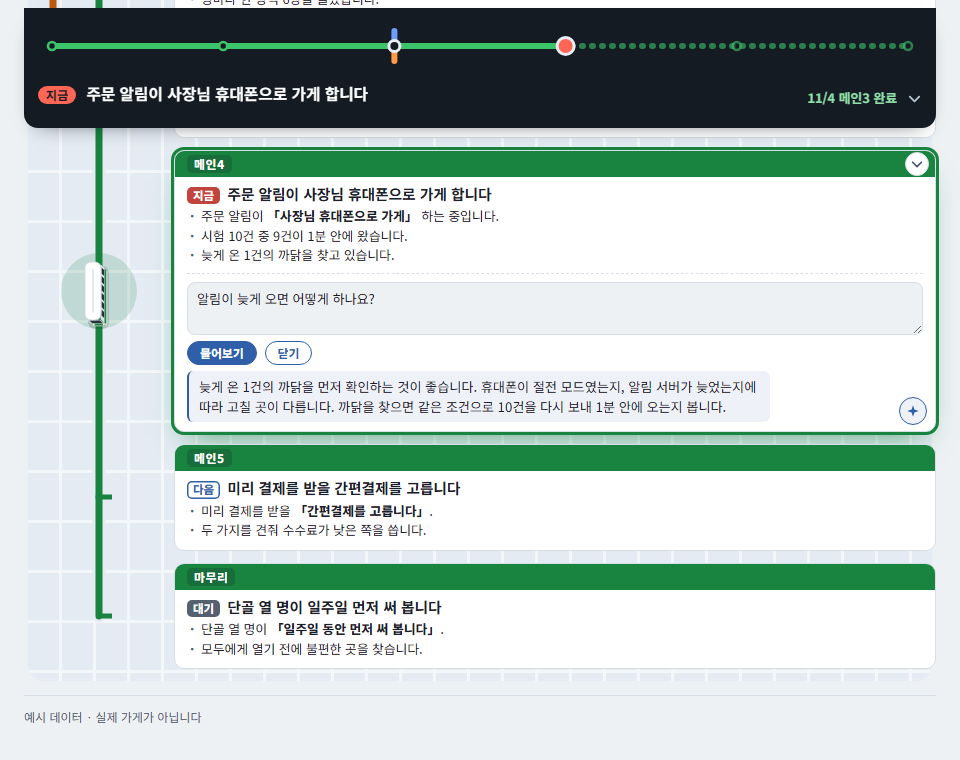
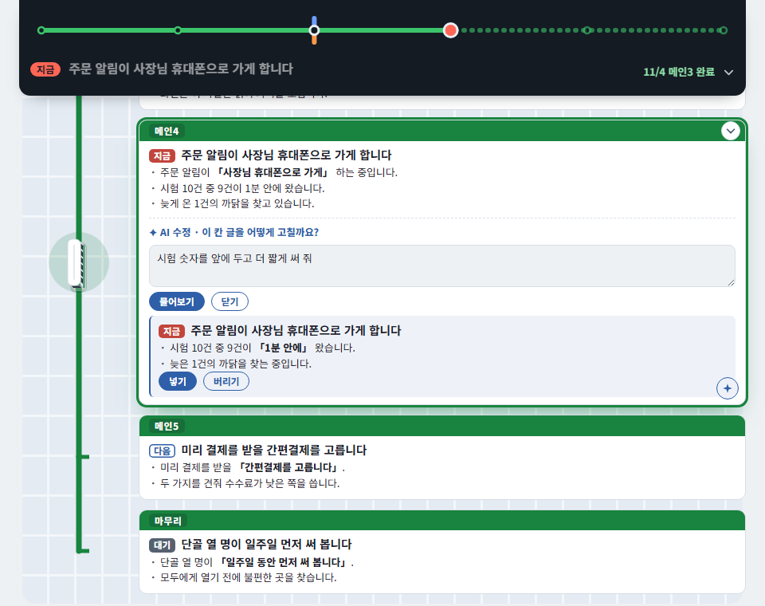
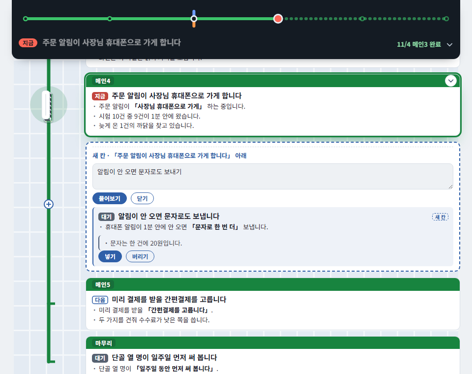

# roadmap-for-vibe-coding

[English](README.md)

**클로드에게 일을 맡기는 동안 끝낸 일과 지금 하는 일을 지하철 노선도 한 장에 보여 주는 스킬입니다.**

| 밝은 화면 | 어두운 화면 |
|---|---|
|  |  |

서버를 깔 필요도, 가입할 필요도 없습니다.
JSON 파일 하나와 HTML 한 장이면 됩니다.

## 이 궤적을 쓰면 좋은 점

### 1. 처음 세운 계획이 끝까지 보입니다

일을 하다 보면 「이것도 해 줘」가 계속 붙습니다.
몇 번 붙고 나면 처음 계획이 어디까지 왔는지 놓칩니다.

이 궤적은 처음 계획을 가운데 **「메인」** 줄에 놓습니다.
중간에 맡긴 일은 오른쪽 **「보조」** 줄로 갈라집니다.
일을 거든 정리는 왼쪽 **「추가」** 줄로 갈라집니다.
일이 아무리 늘어도 메인 줄만 따라가면 계획이 어디까지 왔는지 보입니다.

### 2. 끝낸 일이 사라지지 않습니다

끝낸 카드도 지나온 역으로 남습니다.
그래서 어제 무엇을 했는지, 지난주에 무엇을 정했는지 다시 찾을 수 있습니다.
맨 위 띠에는 **「빨간 점」**이 지금 서 있는 역을 짚습니다.

### 3. 진행판을 클로드가 고칩니다

손으로 고치는 진행판은 금방 낡습니다.
이 궤적은 **「클로드가 JSON 파일 하나를 고치고」** 명령 한 줄로 화면을 다시 만듭니다.
맨 위 띠에 마지막으로 끝낸 날짜가 보여서 낡은 판도 바로 알아봅니다.

### 4. 클로드가 계획을 마음대로 늘리지 못합니다

메인 줄에 카드를 더하거나 빼면 생성기가 멈춥니다.
사람이 **「`--메인승인 "까닭"`」**을 붙여야 다시 만듭니다.
붙인 글은 데이터에 기록으로 쌓입니다.

### 5. 카드 한 장이 10초면 읽힙니다

카드는 제목 한 줄과 요약 1~3문장뿐입니다.
점검기가 긴 문장과 낱말 나열을 막습니다.
그래서 클로드가 써도 **「짧고 또렷한 글」**만 남습니다.

### 6. 화면에서 고치고 클로드에게 묻습니다

카드를 끌어 순서를 바꿉니다.
열차를 끌어 일을 끝냅니다.
카드마다 클로드에게 물어볼 수 있습니다.
글 고치기와 새 카드 쓰기도 클로드에게 맡깁니다.
아래에 기능을 전부 보입니다.

## 할 수 있는 일 전부

### 손으로 옮기기

**카드를 끌어 순서를 바꿉니다.**
끄는 동안 놓일 자리에 파란 틈이 생깁니다.
화면 아래에는 휴지통과 「AI 수정」 칸이 뜹니다.
휴지통에 놓으면 그 카드를 버립니다.



**열차를 끌어 카드를 끝냅니다.**
열차를 다음 역으로 옮기면 떠난 카드는 오늘 날짜로 「완료」가 됩니다.
새로 선 역은 「지금」이 됩니다.


**역을 끌어 다른 줄로 옮깁니다.**
역 점을 다른 역에 놓으면 두 역을 잇습니다.
보조나 추가 줄에 놓으면 그 카드를 그 줄로 옮깁니다.


### 클로드와 함께(claude.ai에서)

**카드마다 물어봅니다(✦).**
카드마다 ✦ 단추가 있습니다.
누르면 클로드가 그 카드의 글을 읽고 답합니다.
그림 속 답은 예시 문구입니다.



**클로드에게 글 고치기를 맡깁니다.**
카드를 「AI 수정」 칸으로 끕니다.
카드를 고르고 E 키를 눌러도 됩니다.
어떻게 고칠지 말하면 클로드가 고친 글을 먼저 보여 줍니다.
「넣기」를 눌러야 카드가 바뀝니다.



**선을 눌러 새 카드를 넣습니다.**
두 카드 사이 선에 마우스를 올리면 ＋가 뜹니다.
＋를 누르고 넣을 일을 말하면 클로드가 그 자리에 맞는 카드를 씁니다.



### 그 밖의 기능

- **지금 위치**: 맨 위 띠에 메인 역이 왼쪽부터 놓입니다. 지금 역에는 빨간 점이 찍힙니다. 역을 누르면 그 카드로 갑니다. 「지금」 줄을 누르면 요약이 펼쳐집니다.
- **줄 설명**: 노선도 위 메인, 보조, 추가를 누르면 말풍선이 뜹니다. 말풍선은 그 궤적의 실제 카드를 예로 들어 줄의 뜻을 설명합니다.
- **보충 설명**: 카드 오른쪽 위 화살표를 누릅니다. 「보충 모두 열기」를 누르면 전부 열립니다.
- **되돌리기**: 띠 아래 「↶ 뒤로」나 Ctrl+Z로 50단계까지 되돌립니다.
- **버린 카드 되살리기**: 노선도 위 「버린 칸 N개」 목록에서 「되살리기」를 누릅니다.
- **이어 보기**: 지난번 「지금」 카드가 그사이 끝났으면 열차가 새 역까지 달려갑니다. 알림도 함께 뜹니다.
- **시작, 마무리, 보류**: 첫 메인 카드는 「시작」, 마지막 메인 카드는 「마무리」로 보입니다. 보류 카드는 빗금과 점선 테두리를 두르고 선로 밖에 놓입니다.
- **키보드**: Alt+↑↓로 카드를 옮기고 Delete로 버립니다. E는 AI 수정입니다. 열차에서는 ↑↓로 옮깁니다. 띠에서는 ←→로 역을 고릅니다.
- **트랙 여러 개**: 한 궤적에 트랙을 여럿 두고 탭으로 오갑니다.
- **저장**: claude.ai에서는 아티팩트에 저장됩니다. 파일로 열면 이 브라우저에 저장됩니다. 「바꾼 것 내보내기」로 파일을 받습니다.
- **화면 모드**: 기기 설정을 따라 밝은 화면과 어두운 화면이 바뀝니다. 휴대폰 화면에도 맞습니다.

## 설치

파이썬 3.8 이상이 있어야 합니다.
윈도우는 `py -3`, 맥과 리눅스는 `python3`로 부릅니다.

**터미널의 클로드 코드**에서는 아래 두 줄을 돌립니다.

```bash
claude plugin marketplace add octooking-byte/roadmap-for-vibe-coding
claude plugin install roadmap-for-vibe-coding@roadmap-for-vibe-coding-market
```

**클로드 데스크톱 앱(코드 탭)이나 VS Code 확장**에서는 클로드에게 이렇게 보냅니다.
`https://github.com/octooking-byte/roadmap-for-vibe-coding 깔아줘`
클로드가 돌리는 명령을 허락하고 새 대화를 엽니다.

**클로드 없이** 보려면 저장소를 받아 `예시/궤적예시.html`을 브라우저로 엽니다.

깐 뒤 클로드 코드에 「이 프로젝트 궤적 만들어 줘」라고 하면 됩니다.
클로드가 예시 데이터를 복사합니다.
메인 계획을 물은 뒤 화면을 만듭니다.

## 데모

`예시/궤적예시.html`을 브라우저로 열면 가상 동네 빵집의 궤적 10칸이 보입니다.
설치할 것은 없습니다.

- 카드를 끌어 순서를 바꿔 봅니다. 열차를 끌어 지금 하는 일도 옮겨 봅니다.
- 고친 것은 이 브라우저에 저장됩니다. 「바꾼 것 내보내기」로 파일을 받습니다.
- 데모를 다시 만들려면 `python3 엔진/궤적만들기.py 예시/궤적데이터.json`을 돌립니다.

## 첫 궤적 만들기

1. `예시/궤적데이터.json`을 내 프로젝트 폴더에 복사합니다.
2. 머리글과 카드를 내 일로 바꿉니다. 가장 작은 모양은 아래와 같습니다.
3. `python3 엔진/궤적만들기.py 내폴더/궤적데이터.json`을 돌립니다. 규칙에 어긋나면 화면을 만들지 않습니다. 고칠 곳은 한 줄씩 알려 줍니다.

```json
{ "판": 9, "출력": "궤적.html",
  "머리": {"창제목": "빵집 궤적", "제목": "단골이 휴대폰으로 빵을 미리 주문하게 합니다",
           "부제목": ["빵집 주문 앱을 만드는 일입니다."], "바닥": "2026 동네 빵집"},
  "트랙": [{"키": "bake", "이름": "주문 앱", "노드": [
    {"id": "b1", "축": 0, "상태": "목표", "질문": "단골이 빵을 미리 주문합니다", "요약": "휴대폰으로 주문받습니다.", "보충": []},
    {"id": "b2", "축": 0, "상태": "지금", "날짜": "11/13", "질문": "주문 화면을 만듭니다", "요약": "빵 6가지를 고르는 화면입니다.", "보충": []},
    {"id": "b3", "축": 1, "상태": "대기", "축이름": "결제", "질문": "간편결제를 붙입니다", "요약": "미리 결제를 받습니다.", "보충": []}]}]}
```

| 칸 | 쓰는 법 |
|---|---|
| `id` | 영문으로 시작, 한 번 붙이면 바꾸지 않음 |
| `축` | 숫자 0(메인), 1(보조), -1(추가). 따옴표 없이 |
| `상태` | 목표, 완료, 지금, 대기, 보류, 다음. 지금은 트랙마다 하나까지 |
| `날짜` | 완료와 지금 카드에 `MM/DD` |
| `마감` | 있을 때만 `YYYY-MM-DD` |
| `질문` | 카드 제목. 36자 안, 「~합니다」로 끝나는 한 문장 |
| `요약` | 1~3문장, 한 문장 45자 안 |
| `보충` | 0~3줄 목록, 없으면 `[]` |
| `축이름` | 보조와 추가 카드의 꼬리표 |

- 문장 안에서 가운뎃점(·)으로 낱말을 늘어놓지 않습니다. 점검기가 막습니다.
- 굵게 보일 곳은 `**「…」**`로 씁니다. 백틱(`` ` ``)으로 감싸면 코드 글자로 보입니다.
- 메인 줄은 처음 세운 계획입니다. 메인 카드를 더하거나 빼면 생성기가 멈춥니다.
- 바꾼 것이 맞으면 `--메인승인 "바꾼 까닭"`을 붙여 다시 돌립니다. 그 글은 데이터의 `메인기록`에 쌓입니다.

## 어디서 무엇이 되나

화면은 세 곳에서 열 수 있습니다.
여는 곳에 따라 되는 기능이 다릅니다.

| 기능 | claude.ai 아티팩트 | 파일로 열기 | 깃허브 페이지 |
|---|---|---|---|
| 노선도 보기, 열 때 지금 카드로 가기 | 됩니다 | 됩니다 | 됩니다 |
| 카드 끌기, 휴지통, 열차 옮기기, 줄 잇기 | 됩니다 | 됩니다 | 됩니다 |
| 되돌리기(Ctrl+Z), 키보드로 카드 옮기기(Alt+↑↓) | 됩니다 | 됩니다 | 됩니다 |
| 고친 것 저장 | 아티팩트 저장소 | 이 브라우저에만 | 이 브라우저에만 |
| 「바꾼 것 내보내기」 단추 | 없습니다 | 있습니다 | 있습니다 |
| ✦ 클로드에게 묻기 | 됩니다 | 안 됩니다 | 안 됩니다 |
| ✦ AI 수정, 선 눌러 새 카드 넣기 | 됩니다 | 안 됩니다 | 안 됩니다 |

- 줄 잇기와 줄 옮기기는 아직 마우스나 손가락으로만 됩니다.
- 「이 브라우저에만」은 브라우저의 localStorage에 둔다는 뜻입니다. 다른 컴퓨터나 다른 브라우저에서는 보이지 않습니다.
- 사생활 보호 창처럼 localStorage가 막힌 곳에서는 저장하지 않고 화면에서만 바뀝니다. 화면 위에 그렇게 적힙니다.
- 클로드를 부르는 기능은 claude.ai가 주는 `sample` 권한으로 돕니다. 파일로 열면 그 단추가 나오지 않습니다.

데이터를 고치는 일은 파이썬 3와 JSON 파일만 씁니다.
그래서 다른 AI 코딩 도구에서도 됩니다.

| 할 일 | 명령 | 클로드 코드 | 다른 AI 코딩 도구 |
|---|---|---|---|
| 카드 쓰고 고치기 | `궤적데이터.json` 고치기 | 됩니다 | 됩니다 |
| 화면 만들기와 점검 | `python3 엔진/궤적만들기.py 궤적데이터.json` | 됩니다 | 됩니다 |
| 화면에서 고친 것을 데이터로 옮기기 | `python3 엔진/궤적접기.py 궤적데이터.json 편집.json` | 됩니다 | 됩니다 |
| claude.ai 저장소에서 편집 꺼내기 | 아티팩트 도구 | 됩니다 | 안 됩니다 |
| claude.ai에 같은 주소로 다시 올리기 | 아티팩트 도구 | 됩니다 | 안 됩니다 |

- `편집.json`은 claude.ai 저장소에서 꺼낸 문서이거나 「바꾼 것 내보내기」로 받은 파일입니다. 두 파일은 모양이 같습니다.
- 다른 AI 코딩 도구는 파일을 고치고 명령을 돌릴 수 있는 도구를 말합니다. 실제로 돌려 본 도구는 클로드 코드뿐입니다.
- 데이터에 `"언어": "en"`(영어 키는 `"language"`)을 쓰면 화면 글이 영어로 나옵니다. 이때 점검기는 한국어 문장 규칙 대신 길이만 봅니다.
- 화면은 크롬, 엣지, 파이어폭스 최신판과 아이폰 사파리에서 열립니다. 메모장이 붙이는 BOM과 맥에서 붙여 넣은 풀어쓴 한글도 그대로 읽습니다.
- 파일로 연 화면에서 고친 것은 파일 이름을 바꾸거나 옮겨도 이어집니다. 다른 탭에서 고친 것도 바로 따라옵니다.

## 라이선스

MIT. [LICENSE](LICENSE)를 봅니다.
