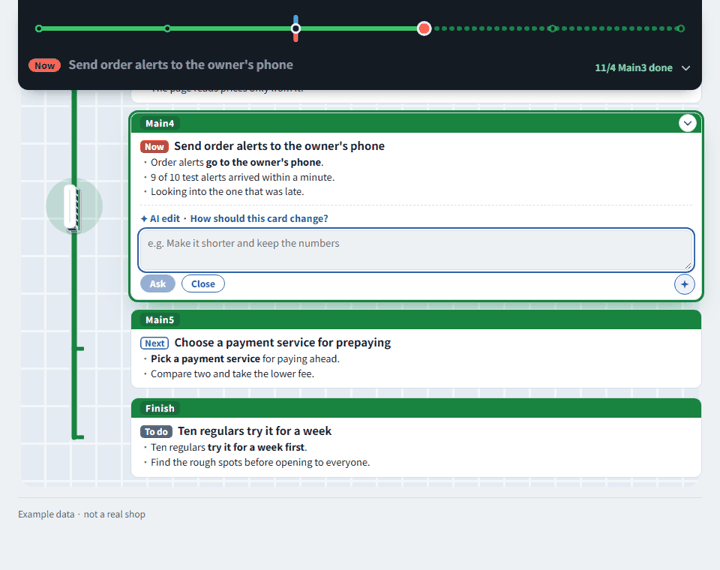

# roadmap-for-vibe-coding

[한국어](README.ko.md)

**A Claude skill that shows what you finished and what you are doing now, on one subway map, while Claude does the work.**

| Light | Dark |
|---|---|
|  |  |

No server to install. No account to create.
One JSON file and one HTML page.

## Why you will like it

### 1. Your first plan stays in view

Work keeps picking up "can you also do this?".
After a few of those, it is hard to tell how far the original plan got.

This roadmap puts your first plan on the **Main** line in the middle.
Requests added along the way branch to the **Side** line on the right.
Cleanup that helped the work branches to the **Extra** line on the left.
However much work piles on, follow the Main line and you see how far the plan got.

### 2. Finished work does not disappear

Finished cards stay on the map as stations you passed.
You can find what you did yesterday and what you decided last week.
A **red dot** on the top strip marks the station you are at now.

### 3. Claude keeps the board up to date

A board you update by hand falls behind.
Here Claude edits one JSON file and rebuilds the page with one command.
The top strip shows the date the last card was finished, so a stale board is easy to spot.

### 4. Claude cannot grow your plan on its own

If a card is added to or removed from the Main line, the builder stops.
It builds again only when you add `--메인승인 "reason"`.
That note is kept in the data as a record.

### 5. Every card reads in ten seconds

A card is a one-line title and a summary of one to three sentences.
The checker blocks long sentences and word lists.
So even cards Claude writes stay short and clear.

### 6. Edit on the page, ask Claude on the page

Drag cards to reorder them. Drag the train to finish a card.
Ask Claude about any card, or let it rewrite a card or write a new one.
Every feature is shown below.

## How a roadmap grows


1. **At first there is only the Main line.** The plan you made becomes stations from top to bottom.
2. **Work you ask for along the way branches to the Side line.** It is the blue line on the right. In the bakery example, the birthday cake orders the owner asked for later are on the Side line.
3. **Cleanup that helps the work branches to the Extra line.** It is the orange line on the left. In the bakery example, gathering menu photos and moving the price list are on the Extra line.
4. A branch closes when its work is done. The Main line runs unbroken to the end.

When Claude takes on new work, it adds cards to the Side or Extra line.
Only you grow the Main line.

## Everything it does

### Move things by hand

**Drag a card to reorder it.** While you drag, a blue gap shows where it will land, and a Trash and an "AI edit" slot appear at the bottom. 
**Throw a card away.** Drop the card you are dragging on the Trash at the bottom. Thrown cards gather in the "N discarded" list above the map, and Restore puts one back.


**Drag the train to finish a card.** Move the train to the next station: the card it left becomes Done with today's date, and the new station becomes Now.


**Move a card to the Side or Extra line.** Drag the station dot next to a card onto the Side or Extra line, and the card moves to that line. Drop the dot on another station to link the two. Side and Extra never link across the Main line.


### Work with Claude (on claude.ai)

**Ask about a card (✦).** Each card has a ✦ button. Claude answers from that card's text. The answer in the picture is an example.


**Let Claude rewrite a card.** Drag the card onto the "AI edit" slot, or select it and press E, and say how to change it. Claude shows the new text first; nothing changes until you press Insert.



**Add a card from the line.** Hover over the line between two cards and press ＋. Say what to add, and Claude writes a card that fits between them.


### Everything else

- **Where am I now**: the top strip lays the Main stations out left to right, with a red dot on the current one. Tap a station to jump to its card. Tap the Now line to read its summary.
- **What the lines mean**: tap Main, Side or Extra above the map. A bubble explains the line with a real card from your roadmap.
- **Notes behind a card**: tap the arrow at the top right of a card, or "Show all notes".
- **Undo**: "↶ Back" under the strip, or Ctrl+Z, up to 50 steps.
- **Restore a thrown card**: "N discarded" above the map lists them, each with Restore.
- **Pick up where you left off**: if last time's Now card is finished when you reopen, the train runs to the new station and a notice tells you.
- **Start, Finish and Parked**: the first Main card reads Start and the last reads Finish. Parked cards get hatching and a dashed border, off the line.
- **Keyboard**: Alt+↑↓ moves a card and Delete throws it away. E opens AI edit. On the train, ↑↓ moves it. On the strip, ←→ picks a station.
- **Several tracks**: a roadmap can hold more than one track. Tabs switch between them.
- **Saving**: on claude.ai, edits are saved in the artifact. Opened as a file, they are saved in this browser, and "Export changes" downloads them.
- **Light, dark, phone**: follows your device theme and fits a phone screen.

## Install

You need Python 3.8 or later (`python3`, or `py -3` on Windows).

**Claude Code in a terminal**: run the two lines below.

```bash
claude plugin marketplace add octooking-byte/roadmap-for-vibe-coding
claude plugin install roadmap-for-vibe-coding@roadmap-for-vibe-coding-market
```

**Claude desktop app (Code tab) or VS Code extension**: send Claude `install https://github.com/octooking-byte/roadmap-for-vibe-coding`. Allow the commands it runs, then start a new session.

**Without Claude**: clone the repo and open `예시/example-en.html` in a browser.

**Claude, installing this for someone?** Follow [INSTALL.md](INSTALL.md).

## Usage

In Claude Code, say "start a roadmap for this project". Claude copies the example data, asks you for the main plan and builds the page.
When a task finishes, say "update the roadmap". Claude moves the train and rebuilds.

By hand:

```bash
python3 엔진/궤적만들기.py 예시/example-en.json   # builds 예시/example-en.html
```

The smallest data file:

```json
{ "version": 9, "output": "roadmap.html", "language": "en",
  "header": {"window_title": "Bakery roadmap", "title": "Regulars order bread ahead from their phones",
             "lede": ["A pre-order page for a neighborhood bakery."], "footer": "2026 bakery"},
  "tracks": [{"key": "bake", "name": "Ordering", "nodes": [
    {"id": "b1", "lane": 0, "status": "goal", "title": "Regulars pre-order bread", "summary": "Orders come from phones.", "notes": []},
    {"id": "b2", "lane": 0, "status": "now", "date": "11/13", "title": "Build the order page", "summary": "Pick from 6 breads.", "notes": []},
    {"id": "b3", "lane": 1, "status": "todo", "label": "Payments", "title": "Add simple payment", "summary": "Take payment up front.", "notes": []}]}]}
```

## Where each feature works

| Feature | claude.ai artifact | Opened as a file |
|---|---|---|
| Map, drag cards and the train, undo | Yes | Yes |
| Saving your edits | Artifact database | This browser only (localStorage) |
| "Export changes" button | No | Yes |
| ✦ Ask Claude, ✦ AI rewrite, add a card from the line | Yes | No |

Editing the data needs only Python 3 and a JSON file, so any AI coding tool that can edit files and run commands can do it. Only Claude Code has been tested.

## Troubleshooting

- **The builder prints rule violations and writes nothing**: fix the cards it names, then run it again.
- **"Main line changed" and the builder stops**: if you meant it, run again with `--메인승인 "why"`.
- **Edits made on the page are gone after a rebuild**: fold them back first with `python3 엔진/궤적접기.py <data.json> <edits.json>`.

## How it works

- `엔진/궤적만들기.py` reads the JSON, runs the checker `엔진/궤적점검.py`, and writes one HTML page from `엔진/궤적틀.html`.
- `엔진/궤적접기.py` copies edits made on the page back into the JSON.
- The builder and checker print their messages in Korean.
- Nothing is sent anywhere by the scripts. The page loads the Noto Sans KR font from Google Fonts; without internet it falls back to the device font.

## License

MIT. See [LICENSE](LICENSE).
