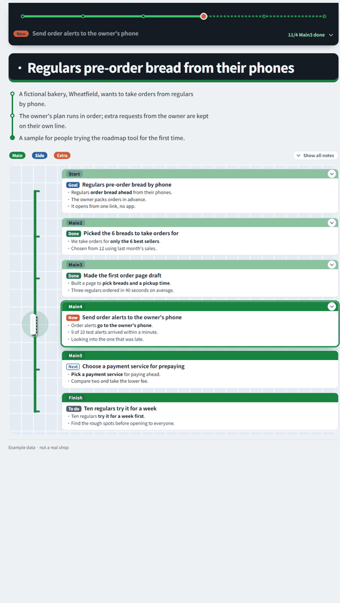
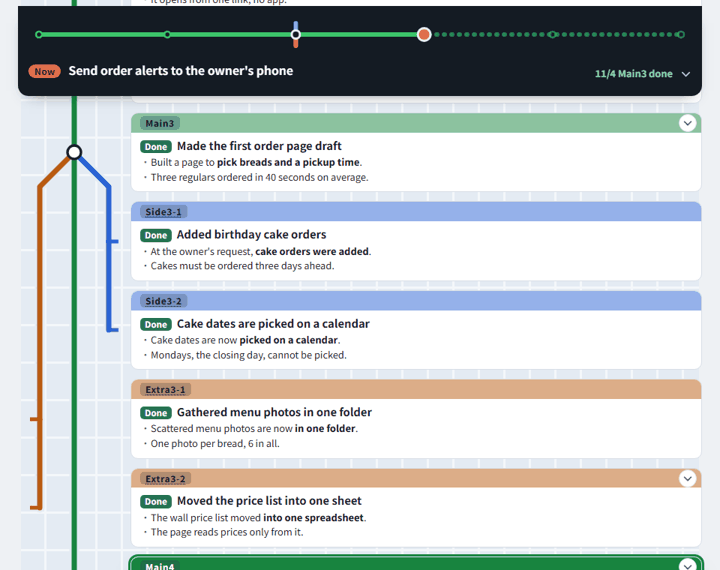
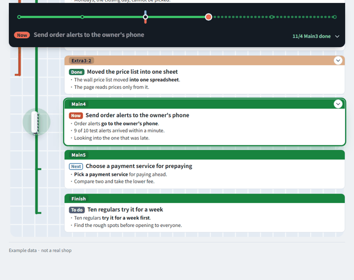
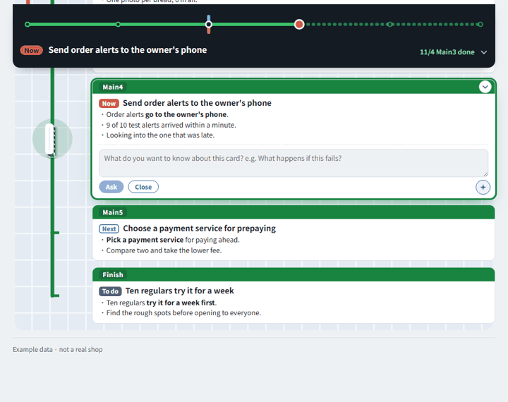
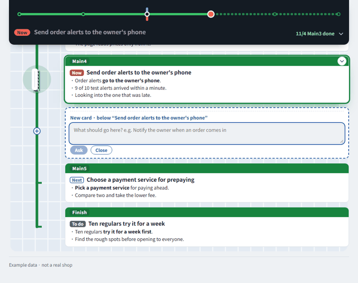
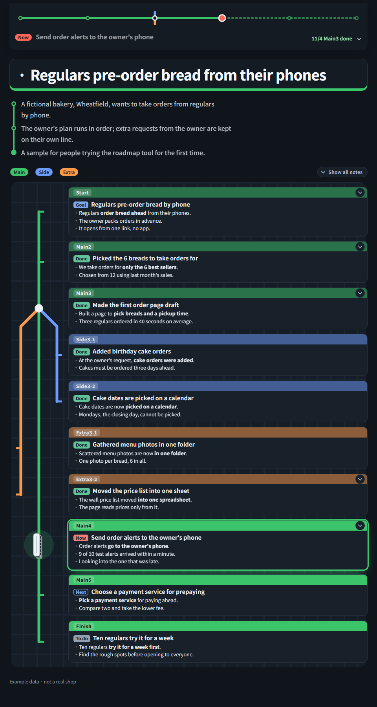

# roadmap-for-vibe-coding

[한국어](README.ko.md)

**See how far the work you gave Claude has come, on one subway map.**


<p align="center">
  
</p>

1. **At first there is only the Main line.** The plan you made becomes stations, top to bottom.
2. **Work you add later branches to the Side line.** It is the blue line on the right. In the picture it is the birthday cake orders the owner asked for later.
3. **Cleanup that helps the work branches to the Extra line.** It is the orange line on the left. In the picture it is gathering menu photos and moving the price list.
4. **When a card is finished, the train moves to the next station.** The station it left turns Done and the new one turns Now.

Only you grow the Main line. Claude puts new work on the Side or Extra line.

## Quick start

Run two lines in a terminal.

```bash
claude plugin marketplace add octooking-byte/roadmap-for-vibe-coding
claude plugin install roadmap-for-vibe-coding@roadmap-for-vibe-coding-market
```

Then tell Claude Code:

> start a roadmap for this project

Claude asks for your plan, writes the data file and builds the page.

To look before you install, clone the repo and open `예시/example-en.html` in a browser. For the desktop app and VS Code, see [Install](#install).

## Why you will like it

### 1. Your plan and the extra requests stay apart

After a few days with Claude, "can you also do this?" keeps piling on. Put everything in one to-do list and you can no longer see how far the original plan got.

This roadmap splits the work into lines. The plan stays on the Main line. Work you add later branches to a side line. Follow the Main line down and you see which station the plan has reached.

### 2. Claude cannot change your plan on its own

If a Main card is added, removed or reordered, the builder stops. It builds again only when you add `--메인승인 "reason"`. Each approval is kept in the data with its date, so you can look up when the plan changed and why.

### 3. You do not update the board by hand

When a task is done, tell Claude "update the roadmap". Claude edits one JSON file and rebuilds the page with one command.

The top strip shows the last finished card and its date. A board that has fallen behind shows it right there.

### 4. Cards stay short

A card is a one-line title and a summary of one to three sentences. On an English page a title can be 72 characters and a summary sentence 90. Past that, the checker builds nothing and names the card to fix. Cards stay the same length after weeks of Claude writing them.

### 5. You edit on the page you are reading

Drag a card to reorder it. Drag the train to finish a card. Undo goes back 50 steps.

On claude.ai you can ask Claude about any card. Claude can also rewrite a card or write a new one, right there. [Everything it does](#everything-it-does) shows each of these in motion.

### 6. No server, no account, no packages

Your data is one JSON file in your own repository, so git shows every change. The builder uses only the Python standard library. The page is a single HTML file that opens straight from disk.

## Everything it does

### Move things by hand

**Drag a card to reorder it.** While you drag, a blue gap shows where it will land. A Trash and an "AI edit" slot appear at the bottom.

**Throw a card away.** Drop the card on the Trash. Thrown cards gather in the "N discarded" list above the map, and Restore puts one back.



**Drag the train to finish a card.** Move the train to the next station. The card it left turns Done with today's date, and the new station turns Now.



**Move a card to the Side or Extra line.** Drag the station dot next to a card onto the Side or Extra line, and the card moves to that line. Drop the dot on another station to link the two.


### Work with Claude

These three work when the page is published as a claude.ai artifact. Claude's text in the pictures is sample text.

**Ask about a card.** Press the ✦ button at the bottom right of a card and type a question. Claude answers from that card's text.



**Let Claude rewrite a card.** Drag the card onto the "AI edit" slot, or select it and press E. Say how to change it, and Claude shows the new text first. Nothing changes until you press Insert.


**Add a card from the line.** Hover over the line between two cards and a ＋ appears. Press it and say what to add. Claude writes a card that fits between the two.



### Everything else

- **Where am I now**: the top strip lays the Main stations out left to right, with a red dot on the current one. Tap a station to jump to its card.
- **Pick up where you left off**: if last time's Now card is finished when you reopen, the train runs to the new station and a notice tells you.
- **What the lines mean**: tap Main, Side or Extra above the map. A bubble explains the line with a real card from your roadmap.
- **Notes behind a card**: tap the arrow at the top right of a card to open its notes, such as the numbers behind a claim. "Show all notes" opens every card.
- **Undo**: "↶ Back" under the strip, or Ctrl+Z, up to 50 steps.
- **Start, Finish and Parked**: the first Main card reads Start and the last reads Finish. Parked cards get hatching and a dashed border, off the line.
- **Due dates**: a card with a due date counts down the days.
- **Keyboard**: Alt+↑↓ moves a card and Delete throws it away. E opens AI edit. On the train, ↑↓ moves it. On the strip, ←→ picks a station.
- **Several tracks**: a roadmap can hold more than one track. Tabs switch between them.
- **Saving**: on claude.ai, edits are saved in the artifact. Opened as a file, they are saved in this browser, and "Export changes" downloads them.
- **Light, dark, phone**: the page follows your device theme and fits a phone screen.
- **English or Korean page**: `"language": "en"` in the data builds an English page.

## The whole page

| Light | Dark |
|---|---|
|  |  |

## Install

You need Python 3.8 or later (`python3`, or `py -3` on Windows).

**Claude Code in a terminal**: run the two lines in [Quick start](#quick-start).

**Claude desktop app (Code tab) or VS Code extension**: send Claude this.

> install https://github.com/octooking-byte/roadmap-for-vibe-coding

Allow the commands it runs, then start a new session. Claude follows [INSTALL.md](INSTALL.md).

**Without Claude**: clone the repo. Building a page needs only Python.

## Your first roadmap

In Claude Code, just say it.

- "start a roadmap for this project": Claude asks for your plan and builds the first page.
- "update the roadmap": Claude marks finished cards Done and moves the train.
- "put this on the Side line": Claude adds work outside the plan to a side line.

By hand it takes three steps.

1. Copy `예시/example-en.json` into your project folder.
2. Replace the header and the cards with your own work. The smallest file looks like the one below.
3. Run `python3 엔진/궤적만들기.py your-folder/example-en.json`.

```json
{ "version": 9, "output": "roadmap.html", "language": "en",
  "header": {"window_title": "Bakery roadmap", "title": "Regulars order bread ahead from their phones",
             "lede": ["A pre-order page for a neighborhood bakery."], "footer": "2026 bakery"},
  "tracks": [{"key": "bake", "name": "Ordering", "nodes": [
    {"id": "b1", "lane": 0, "status": "goal", "title": "Regulars pre-order bread", "summary": "Orders come from phones.", "notes": []},
    {"id": "b2", "lane": 0, "status": "now", "date": "11/13", "title": "Build the order page", "summary": "Pick from 6 breads.", "notes": []},
    {"id": "b3", "lane": 1, "status": "todo", "label": "Payments", "title": "Add simple payment", "summary": "Take payment up front.", "notes": []}]}]}
```

| Field | Rule |
|---|---|
| `id` | Starts with a letter. Never changed once set |
| `lane` | 0 (Main), 1 (Side), -1 (Extra). A number, no quotes |
| `status` | goal, done, now, todo, parked, next. One `now` per track at most |
| `date` | `MM/DD` on done and now cards |
| `due` | Optional `YYYY-MM-DD` |
| `title` | One sentence, 72 characters or fewer |
| `summary` | 1 to 3 sentences, 90 characters or fewer each |
| `notes` | 0 to 3 lines, 120 characters or fewer each. `[]` if none |
| `label` | A short tag on Side and Extra cards |

- If a rule is broken, the builder writes nothing and prints what to fix, one line each.
- Mark the phrase that matters with `**...**`. Backticks show as code.
- The full field reference is in [skills/roadmap/SKILL.md](skills/roadmap/SKILL.md).

## Where each feature works

| Feature | claude.ai artifact | Opened as a file |
|---|---|---|
| The map, dragging cards, moving the train, linking lines | Yes | Yes |
| Undo, moving cards by keyboard | Yes | Yes |
| Saving your edits | Artifact database | This browser only |
| "Export changes" button | No | Yes |
| ✦ Ask, AI edit, add a card from the line | Yes | No |

- Linking lines and moving a card to another line work by mouse or touch only for now.
- "This browser only" means the browser's localStorage. Other computers and other browsers do not see it.
- Where localStorage is blocked, such as a private window, edits change the page but are not saved. The page says so at the top.
- The page opens in current Chrome, Edge and Firefox, and in Safari on iPhone.

Editing the data needs only Python 3 and a JSON file. Any AI coding tool that can edit files and run commands can do it. Only Claude Code has been tested.

## FAQ

**Can I use it without Claude?**
Yes. Viewing the map, dragging cards, moving the train and undo all work from a file. Only ✦ Ask, AI edit and adding a card from the line need claude.ai.

**Where does my data go?**
Nowhere. The builder and the checker run on your computer and send nothing. The page loads one font (Noto Sans KR) from Google Fonts. Without internet it uses the device font.

**How do I change the Main line?**
Edit the Main cards in the data, then run the builder with `--메인승인 "why"`. The note is kept in the data under `main_log`.

**Do edits made on the page survive a rebuild?**
Yes, if you fold them back first. Give the file from "Export changes" to `python3 엔진/궤적접기.py <data.json> <edits.json>`. In Claude Code, Claude does this when it updates the roadmap.

**The builder prints violations and stops.**
Fix the cards it names and run it again. Most often a title or a summary is too long.

**Why are the script messages and file names in Korean?**
The tool was built in Korean first. The page and the data keys work in English. The builder's messages and the folder names are still Korean.

## How it works

- `엔진/궤적만들기.py` reads the JSON, runs the checker `엔진/궤적점검.py`, and writes one HTML page from the template `엔진/궤적틀.html`.
- `엔진/궤적접기.py` copies edits made on the page back into the JSON.
- `skills/roadmap/SKILL.md` is the guide Claude reads.

## Found something to fix?

Open an [issue](https://github.com/octooking-byte/roadmap-for-vibe-coding/issues). Say which screen you were on and what you did, and it gets fixed faster.

If it turned out useful, a star helps the next person find it.

## License

MIT. See [LICENSE](LICENSE).
