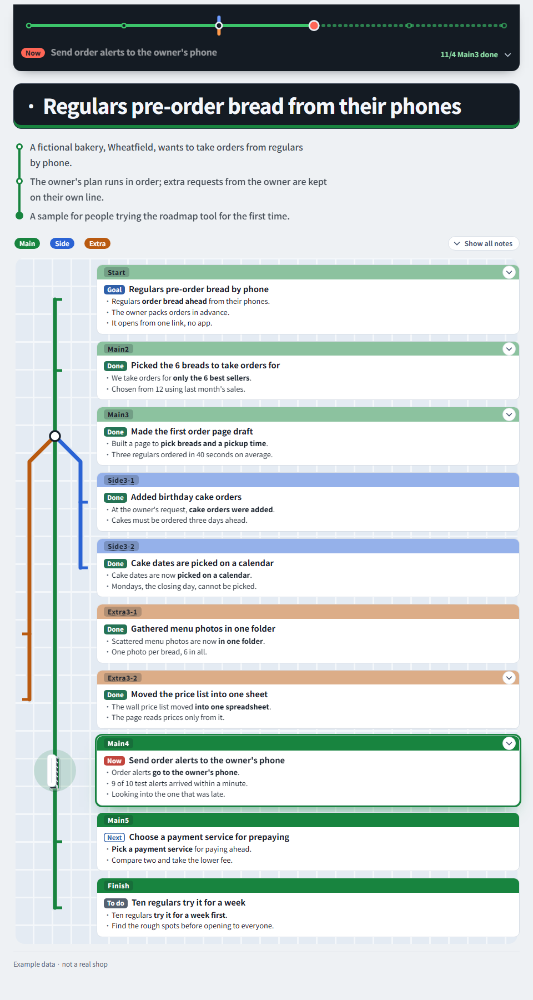
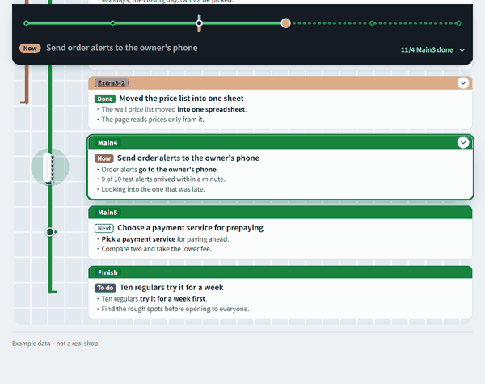
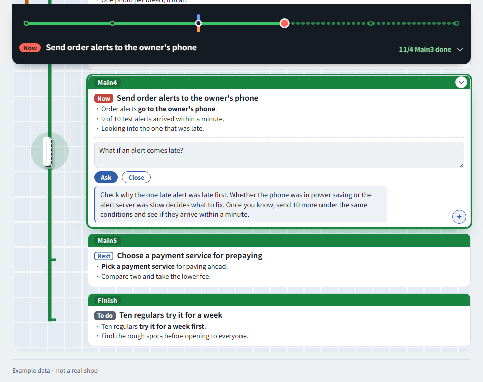
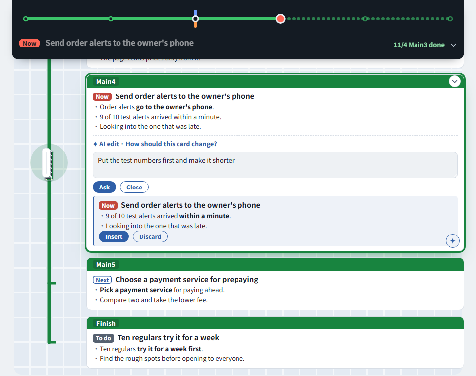
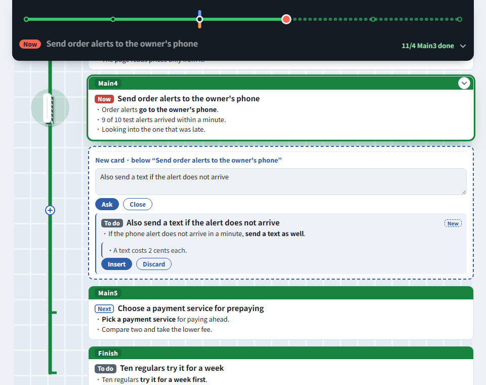

# roadmap-for-vibe-coding

**See where your plan bent while an AI writes the code — on one subway map.**

[한국어](README.ko.md)

| Light | Dark |
|---|---|
|  |  |

No server, no sign-up. One JSON file and one HTML page.

## Why use it

**1. Plans bend quietly when you code with an AI.**
"Can you also do this?" and the AI takes a side road. After a few side roads, nobody remembers the original plan. This tool pins the plan you made to the **Main** line in the middle. New requests branch off to the **Side** line on the right; cleanup that helped the work goes to the **Extra** line on the left. Every place the plan bent stays on the map.

**2. Kanban boards only show "now".**
A kanban board moves cards across To do, Doing and Done, and finished cards pile up out of sight. A subway map shows the stations you passed and the ones ahead on one page. The red dot on the top strip tells you which station you are at.

**3. Progress boards go stale.**
A board that someone has to update by hand falls behind the real work. Here the AI edits one JSON file and rebuilds the page with one command. Once a Main card is finished, the top strip shows the date it was finished, so a stale board is obvious.

**4. The AI cannot grow your plan on its own.**
If the Main line gains or loses a card, the builder stops. It builds again only with `--메인승인 "reason"` from you, and that note is kept in the data.

**5. Readable in ten seconds.**
Each card is a one-line title and a summary of one to three sentences. The checker blocks long sentences, so even AI-written cards stay short.

## How it compares

Star counts measured on GitHub on 2026-11-14.

| Tool | Stars | Good at | How this one differs |
|---|---|---|---|
| [Vibe Kanban](https://github.com/BloopAI/vibe-kanban) | 28,674 | Running several coding agents side by side on a kanban board | It does not run agents. It keeps the plan and the detours on separate lines, so you can see how the work actually went |
| [Task Master](https://github.com/eyaltoledano/claude-task-master) | 28,359 | Breaking a requirements doc into tasks for the AI | It does not create tasks. It shows how far the tasks got, on one page |
| [Backlog.md](https://github.com/MrLesk/Backlog.md) | 7,372 | Managing tasks as Markdown files in the repo | It draws a map instead of a list, so the original plan and the side roads separate at a glance |

Those tools help with "what next?". This one shows "where did the plan bend?". They work fine together.

## Everything it does

### Move things by hand

**Drag a card to reorder it.** While you drag, a blue gap shows where it will land, and a Trash and an "AI edit" slot appear at the bottom. Drop it on the Trash to throw it away.


**Drag the train to finish a card.** Move the train to the next station: the card it left becomes Done with today's date, and the new station becomes Now.


**Drag a station to another line.** Drag a station dot onto another station to link them, or onto the Side or Extra line to move the card there.



### Work with Claude (on claude.ai)

**Ask about a card (✦).** Each card has a ✦ button. Claude answers from that card's text. The answer in the picture is an example.



**Let Claude rewrite a card.** Drag the card onto the "AI edit" slot, or select it and press E, and say how to change it. Claude shows the new text first; nothing changes until you press Insert.



**Add a card from the line.** Hover over the line between two cards and press ＋. Say what to add, and Claude writes a card that fits between them.



### Everything else

| Feature | How |
|---|---|
| Where am I now | The top strip lays the Main stations out left to right with a red dot on the current one. Tap a station to jump to its card; tap the Now line to read its summary |
| What the lines mean | Tap Main, Side or Extra above the map; a bubble explains it with a real card from your roadmap |
| Notes behind a card | Tap the arrow on a card, or "Show all notes" |
| Undo | "↶ Back" under the strip, or Ctrl+Z, up to 50 steps |
| Restore a thrown card | "N discarded" above the map lists them, each with Restore |
| Pick up where you left off | If the card that was Now last time is finished when you reopen, the train runs to the new station and a notice tells you |
| Start, Finish and Parked | The first Main card reads Start, the last reads Finish. Parked cards are hatched with a dashed border, off the line |
| Keyboard | Alt+↑↓ moves a card, Delete throws it away, E opens AI edit, ↑↓ on the train moves it, ←→ on the strip picks a station |
| Several tracks | A roadmap can hold more than one track; tabs switch between them |
| Saving | On claude.ai, edits are saved in the artifact. Opened as a file, they are saved in this browser, and "Export changes" downloads them |
| Light, dark, phone | Follows your device theme and fits a phone screen |

## Install

You need Python 3.8 or later (`python3`, or `py -3` on Windows).

| Where you use it | How to install |
|---|---|
| Claude Code in a terminal | Run the two lines below |
| Claude desktop app (Code tab), VS Code extension | Send Claude `install https://github.com/octooking-byte/roadmap-for-vibe-coding`, allow the commands it runs, then start a new session |
| Without Claude | Clone the repo and open `예시/example-en.html` in a browser |

```bash
claude plugin marketplace add octooking-byte/roadmap-for-vibe-coding
claude plugin install roadmap-for-vibe-coding@roadmap-for-vibe-coding-market
```

**Claude, installing this for someone?** Follow [INSTALL.md](INSTALL.md).

## Usage

In Claude Code, say "start a roadmap for this project". Claude copies the example data, asks you for the main plan and builds the page.
When a task finishes, say "update the roadmap". Claude moves the train and rebuilds.

By hand:

```bash
python3 엔진/궤적만들기.py 예시/example-en.json   # builds 예시/example-en.html
```

The smallest data file:

```json
{ "version": 9, "output": "roadmap.html", "language": "en",
  "header": {"window_title": "Bakery roadmap", "title": "Regulars order bread ahead from their phones",
             "lede": ["A pre-order page for a neighborhood bakery."], "footer": "2026 bakery"},
  "tracks": [{"key": "bake", "name": "Ordering", "nodes": [
    {"id": "b1", "lane": 0, "status": "goal", "title": "Regulars pre-order bread", "summary": "Orders come from phones.", "notes": []},
    {"id": "b2", "lane": 0, "status": "now", "date": "11/13", "title": "Build the order page", "summary": "Pick from 6 breads.", "notes": []},
    {"id": "b3", "lane": 1, "status": "todo", "label": "Payments", "title": "Add simple payment", "summary": "Take payment up front.", "notes": []}]}]}
```

## Where each feature works

| Feature | claude.ai artifact | Opened as a file |
|---|---|---|
| Map, drag cards and the train, undo | Yes | Yes |
| Saving your edits | Artifact database | This browser only (localStorage) |
| "Export changes" button | No | Yes |
| ✦ Ask Claude, ✦ AI rewrite, add a card from the line | Yes | No |

Editing the data needs only Python 3 and a JSON file, so any AI coding tool that can edit files and run commands can do it. Only Claude Code has been tested.

## Troubleshooting

| Problem | Fix |
|---|---|
| The builder prints rule violations and writes nothing | Fix the cards it names, then run it again |
| "Main line changed" and the builder stops | If you meant it, run again with `--메인승인 "why"` |
| Edits made on the page are missing after a rebuild | Fold them back first: `python3 엔진/궤적접기.py <data.json> <edits.json>` |

## How it works

- `엔진/궤적만들기.py` reads the JSON, runs the checker `엔진/궤적점검.py`, and writes one HTML page from `엔진/궤적틀.html`.
- `엔진/궤적접기.py` copies edits made on the page back into the JSON.
- The builder and checker print their messages in Korean.
- Nothing is sent anywhere by the scripts. The page loads the Noto Sans KR font from Google Fonts; without internet it falls back to the device font.

## License

MIT. See [LICENSE](LICENSE).
